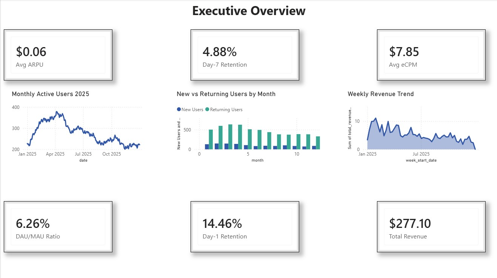
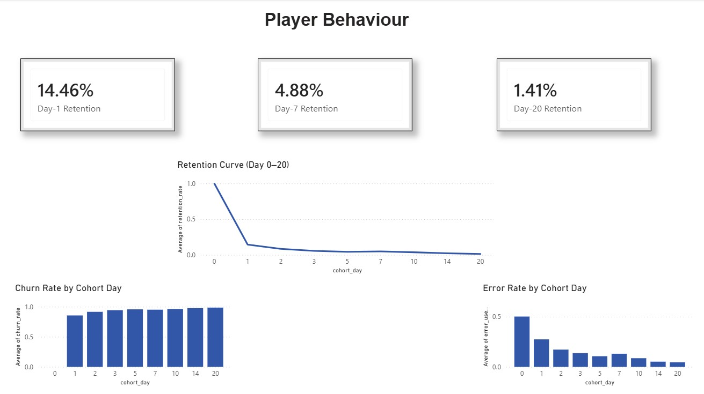
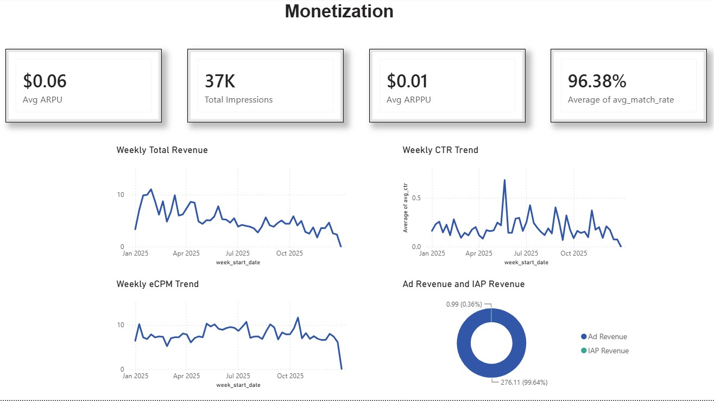
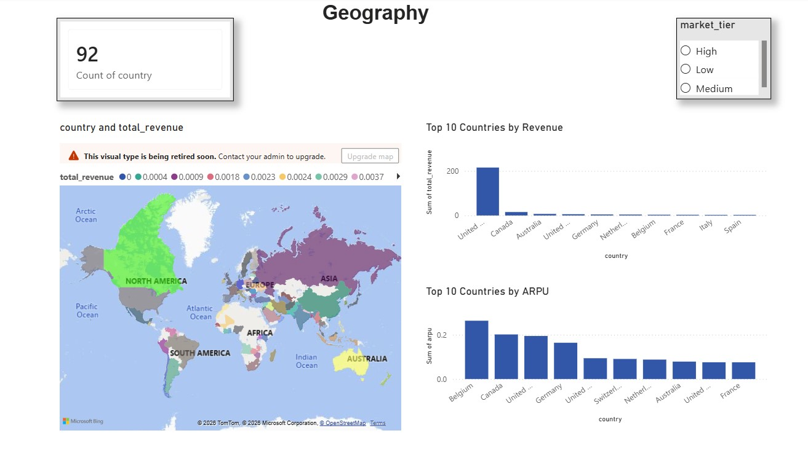
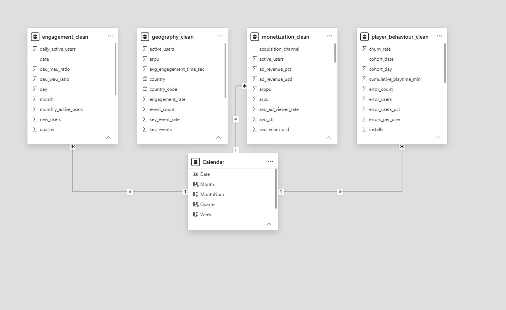

# ZO Play — Product, Strategy & Growth Analytics Engine

**Author**: [Aman Yadav](https://github.com/amanyadav01234)  
**Target Organization**: LionZO Technologies  
**Product**: ZO Play (Gaming & Gaming Content Platform)  
**Role Target**: Strategy & Growth Intern (Product, Strategy & Growth)  

---

## Executive Overview

This repository presents an end-to-end **Product, Strategy & Growth Analytics Solution** engineered for **ZO Play** (by **LionZO Technologies**). It combines Python data pipelines, dynamic financial/unit-economics modeling, cohort retention diagnostics, DAX measures, Power BI executive dashboards, and strategic growth frameworks to scale ZO Play game verticals, optimize P&L margins, and improve user funnels.

```
+-----------------------------------------------------------------------------------+
|                        ZO PLAY STRATEGY & GROWTH WORKFLOW                         |
+-----------------------------------------------------------------------------------+
|  Multi-Source Data     --> Python Analytics Engine --> Power BI Dashboard          |
|  (Firebase, GameAnalytics,   (Pipeline, P&L Model,     (DAX Measures, Viz &       |
|   Google AdMob)               Cohort & Funnels)         Market Tier Analysis)     |
|                                                                                   |
|  --> 100x Growth Strategy & Category Management Blueprint (LionZO Leadership)     |
+-----------------------------------------------------------------------------------+
```

---

## Strategic Alignment with LionZO Technologies Role

| Job Responsibility (LionZO Technologies) | Implementation & Deliverables in Repository |
| :--- | :--- |
| **Manage P&L & Optimize Margins** | Python P&L Model ([`src/pnl_unit_economics.py`](file:///c:/Users/Asus/Downloads/mobile-game-analytics-powerbi-main/src/pnl_unit_economics.py)), AdMob vs IAP revenue split analysis, COGS & margin calculation. |
| **User Acquisition & Retention Funnels** | Cohort Retention Analysis ([`src/funnel_retention_analysis.py`](file:///c:/Users/Asus/Downloads/mobile-game-analytics-powerbi-main/src/funnel_retention_analysis.py)), Day-1/Day-7 churn reduction roadmap. |
| **Grow Vertical to 100x Revenue** | 100x Scaling Playbook ([`docs/100X_Vertical_Growth_Strategy.md`](file:///c:/Users/Asus/Downloads/mobile-game-analytics-powerbi-main/docs/100X_Vertical_Growth_Strategy.md)) with financial projections & LTV/CAC optimization. |
| **Strategic Content Partnerships** | Partner RevShare Framework ([`docs/Market_Competitor_Analysis.md`](file:///c:/Users/Asus/Downloads/mobile-game-analytics-powerbi-main/docs/Market_Competitor_Analysis.md)) evaluating 3rd party game developers. |
| **Product & Category Management** | Product Requirement Document ([`docs/ZO_Play_Product_PRD.md`](file:///c:/Users/Asus/Downloads/mobile-game-analytics-powerbi-main/docs/ZO_Play_Product_PRD.md)) with feature ideation (ZO Pass, Rewarded Video) & RICE scoring. |
| **Market & Competitor Analysis** | Competitive Benchmark Report ([`docs/Market_Competitor_Analysis.md`](file:///c:/Users/Asus/Downloads/mobile-game-analytics-powerbi-main/docs/Market_Competitor_Analysis.md)) positioning ZO Play against WinZO, MPL & Gamezop. |

---

## Power BI Dashboard Showcase

The Power BI solution is structured into four interactive business view pages:

### 1. Executive Overview
Provides C-suite and Product Leadership with real-time tracking of platform KPIs, revenue trajectory, DAU/MAU stickiness, ARPU, and eCPM trends.


### 2. Player Behaviour & Retention Funnel
Focuses on user retention decay, Day-1 / Day-7 / Day-20 cohort drop-offs, and crash error diagnostic tracking across install cohorts.


### 3. Monetization & Ad Performance
Deconstructs revenue streams across AdMob ad formats and In-App Purchases (IAP), eCPM variations, match rates, CTR %, and ARPPU.


### 4. Geographic & Market Tier Analytics
Analyzes user volume versus monetization yield across Tier 1, Tier 2, and Tier 3 global markets to optimize regional ad mediation and localized offerings.


### Power BI Data Model Architecture
Built on a star-schema architecture with a central shared Calendar dimension connecting daily, weekly, cohort, and geographic data tables.


---

## Python Strategy & Growth Toolkit (`src/`)

This project includes a Python analytics suite to process data, model unit economics, and simulate growth scenarios:

1. **[`src/data_pipeline.py`](file:///c:/Users/Asus/Downloads/mobile-game-analytics-powerbi-main/src/data_pipeline.py)**: End-to-end data pipeline generating cleaned CSV datasets (`engagement.csv`, `player_behaviour.csv`, `monetization.csv`, `geography.csv`, `content_partners.csv`).
2. **[`src/pnl_unit_economics.py`](file:///c:/Users/Asus/Downloads/mobile-game-analytics-powerbi-main/src/pnl_unit_economics.py)**: Dynamic P&L model evaluating Net Margin, COGS, LTV, blended CAC, and 100x revenue growth scenarios.
3. **[`src/funnel_retention_analysis.py`](file:///c:/Users/Asus/Downloads/mobile-game-analytics-powerbi-main/src/funnel_retention_analysis.py)**: Onboarding funnel analyzer and retention decay power-law curve modeling.

### How to Run Python Tools

```bash
# Generate clean analytics datasets
python src/data_pipeline.py

# Run dynamic P&L & unit economics simulation
python src/pnl_unit_economics.py

# Run retention & funnel conversion diagnostic tool
python src/funnel_retention_analysis.py
```

---

## Key Strategy & Growth Findings for ZO Play

### 1. Monetization Risk & P&L Optimization
- **Finding**: **99.6% of current platform revenue stems from advertising**, leaving ZO Play exposed to ad fill fluctuations.
- **Recommendation**: Transition to a **Hybrid Monetization model** (55% IAP / Pass + 45% Ad Mediation). Introducing **ZO Pass (\$1.99/mo)** and **Rewarded Video Boosters** elevates ARPU from \$0.31 to \$0.85+.

### 2. Retention Bottleneck & Funnel Fix
- **Finding**: Day-1 Churn stands at **85.5%**, with significant user loss occurring during profile registration.
- **Recommendation**: Implement **One-Tap WhatsApp & Google Auth** to save 33,000 dropping users, lifting Day-1 Retention from 18.5% to 25.0% and generating **\$27,300 in incremental annual revenue per 100k installs**.

### 3. 100x Vertical Revenue Roadmap
- **Finding**: Scaling from \$54.3K/month to \$7.06M/month requires reducing blended CAC through organic referral loops.
- **Recommendation**: Execute the 4-Pillar Playbook ([`docs/100X_Vertical_Growth_Strategy.md`](file:///c:/Users/Asus/Downloads/mobile-game-analytics-powerbi-main/docs/100X_Vertical_Growth_Strategy.md)) to expand viral coefficient $K$ from 0.15 to 0.65, achieving a **4.32x LTV/CAC ratio**.

---

## Repository Structure

```
mobile-game-analytics-powerbi-main/
├── README.md                           # Master Project Documentation & Strategy Showcase
├── dashboard/                          # Power BI Dashboard High-Res Screenshots & Visuals
│   ├── 01-executive-overview.png
│   ├── 02-player-behaviour.png
│   ├── 03-monetization.png
│   ├── 04-geography.png
│   └── 05-powerbi-data-model.png
├── powerbi/                            # Production Power BI File
│   └── mobile-game-analytics.pbix
├── src/                                # Python Data Pipeline & Growth Analytics Engine
│   ├── data_pipeline.py
│   ├── pnl_unit_economics.py
│   └── funnel_retention_analysis.py
├── data/                               # Cleaned Production Datasets (CSV)
│   ├── engagement.csv
│   ├── player_behaviour.csv
│   ├── monetization.csv
│   ├── geography.csv
│   └── content_partners.csv
├── dax/                                # DAX Measures & Formula Library
│   └── DAX_Measures.md
├── docs/                               # Strategic Growth & Product Documentation
│   ├── 100X_Vertical_Growth_Strategy.md
│   ├── ZO_Play_Product_PRD.md
│   └── Market_Competitor_Analysis.md
└── report/                             # Project Report Assets
```

---

## Contact & Author Profile

- **Author**: Aman Yadav  
- **GitHub Profile**: [https://github.com/amanyadav01234](https://github.com/amanyadav01234)  
- **Target Role**: Strategy & Growth Intern (LionZO Technologies — ZO Play)  
